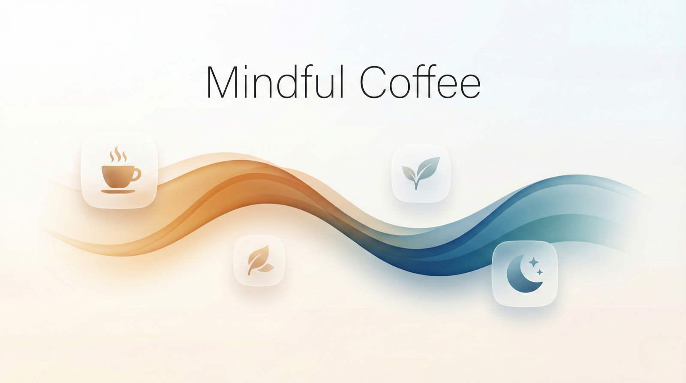
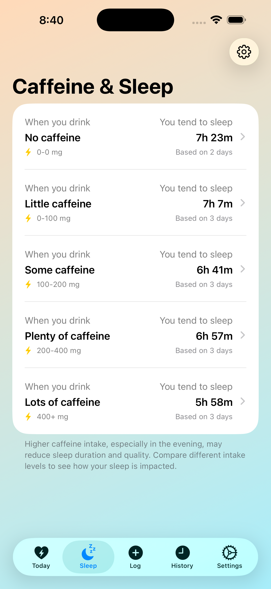
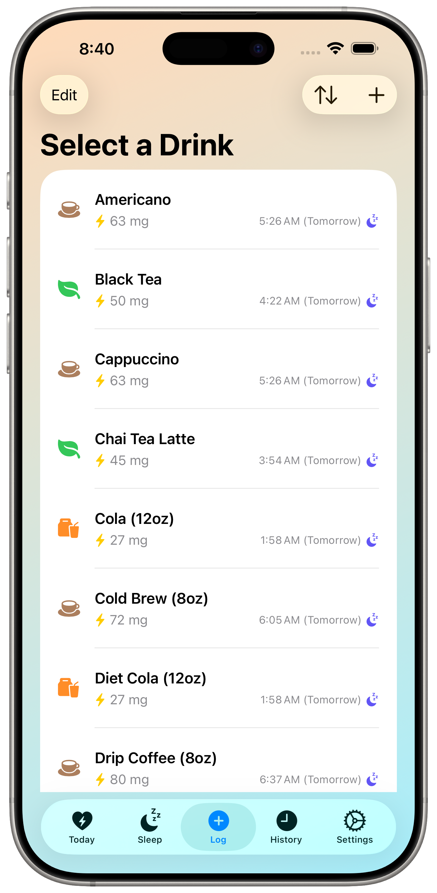
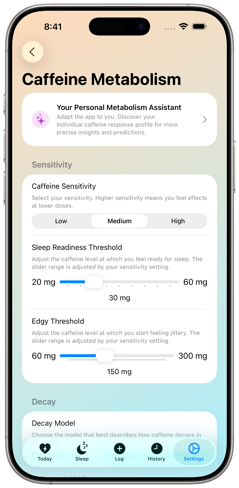

🇺🇸 [English](README.md) | 🇩🇪 [Deutsch](README_de.md) | 🇪🇸 [Español](README_es.md) | 🇫🇷 [Français](README_fr.md) | 🇮🇹 **Italiano** | 🇧🇷 [Português](README_pt-BR.md) | 🇳🇱 [Nederlands](README_nl.md) | 🇸🇪 [Svenska](README_sv.md) | 🇯🇵 [日本語](README_ja.md) | 🇰🇷 [한국어](README_ko.md) | 🇨🇳 [简体中文](README_zh-Hans.md) | 🇹🇼 [繁體中文](README_zh-Hant.md)

# Mindful Coffee - Tracker della caffeina e diario di preparazione per iPhone, iPad e Mac

  

**Prepara meglio. Dormi meglio.**

Mindful Coffee è l'unica app per iOS che unisce un **Diario di preparazione** completo a un modello della caffeina basato sul tuo metabolismo personale e alla previsione del sonno direttamente sul dispositivo. Registra ogni espresso, V60, AeroPress, Chemex, cold brew, matcha o tè, scopri con precisione quando la caffeina lascerà il tuo organismo e comprendi il ritmo naturale del cortisolo del tuo corpo. Realizzata con il linguaggio di design **Liquid Glass** di Apple. Fa parte della famiglia **Mindful Apps**, insieme a [Mindful Body](https://github.com/aloth/mindful-body).

## In evidenza

### ☕ Diario di preparazione
Espresso, V60, AeroPress, Chemex, French press, moka, cold brew, e poi tè, matcha e Gong Fu. Annota macinatura, dose, rapporto, tempo, temperatura e valutazione in un unico flusso elegante. Ricette integrate, suggerimenti intelligenti per trovare più in fretta la regolazione giusta e analisi delle preparazioni per scoprire la tua tazza migliore.

### 🧬 Modello di cortisolo e caffeina
Un modello personale dell'emivita prevede quando la caffeina lascerà il tuo organismo e quando il tuo corpo sarà pronto per dormire. La vista del ritmo del cortisolo mostra la tua curva naturale di energia, così puoi bere il caffè nelle finestre in cui aiuta davvero. Il tuo solito orario di sveglia viene ricavato automaticamente dai dati sul sonno di Apple Salute (la mediana di un massimo di 14 notti, non una singola mattina), quindi i consigli sulla tempistica si adattano al tuo ritmo reale senza alcuna configurazione.

### ❤️ Body Insights da Apple Salute
Metti a confronto la caffeina che assumi con la reale risposta del tuo corpo. La Correlazione con il sonno mostra come cambia la durata del sonno con diversi livelli di assunzione giornaliera. La Correlazione con la frequenza cardiaca a riposo (Pro) rivela se più caffè sposta verso l'alto il tuo valore cardiovascolare di base.

### ⌚ Apple Watch e Siri
Complicazioni «Caffeina ora» e «Previsione sonno» su tutti i quadranti moderni. Tocca una complicazione per registrare la tua bevanda predefinita in un'unica schermata. «Ehi Siri, log a coffee» funziona senza aprire l'app. Gli avvisi delle finestre di cortisolo ti richiamano nei momenti giusti.

### 🤖 Insight AI, interamente sul dispositivo
Apple Intelligence genera commenti personalizzati sulla caffeina che si adattano ai tuoi livelli di energia, al momento della giornata e alle tue abitudini di sonno. La base di ricerca sull'AI è il [progetto JudgeGPT](https://github.com/aloth/JudgeGPT). Nulla lascia il tuo dispositivo.

### 🔒 Integrazione con Apple e privacy
La sincronizzazione con HealthKit scrive la caffeina in Apple Salute e legge i dati sul sonno e sulla frequenza cardiaca a riposo. Sincronizzazione iCloud tra iPhone, iPad e Mac. Esportazione CSV per avere il pieno controllo dei tuoi dati. Tutti i calcoli e l'AI vengono eseguiti in locale: niente account, niente server, niente telemetria.

## Funzioni Pro

| Funzione | Pro? |
|---|---|
| Diario di preparazione e analisi delle preparazioni | Pro |
| Analisi della correlazione con la FC a riposo | Pro |
| Insight AI (Apple Intelligence) | Pro |
| Personalizzazione widget | Pro |
| Sincronizzazione bidirezionale con HealthKit e importazione/esportazione CSV | Pro |
| Monitoraggio di caffeina e cortisolo, previsione del sonno, correlazione con il sonno, widget, complicazioni per Apple Watch, Siri | Gratis |

*Gli Insight AI richiedono iPhone 15 Pro o serie 16, iPad Air/Pro con M1+, iPad mini con A17 Pro o Mac con Apple Silicon, con iOS 18.1+ / iPadOS 18.1+ / macOS 15.1+.*

## Screenshot

<table>
<tr>
<td width="50%">

### Monitoraggio in tempo reale di caffeina e cortisolo
La curva di decadimento della caffeina accanto al ritmo naturale del cortisolo del tuo corpo, con consigli personalizzati sulla tempistica.

</td>
<td width="50%">

### Body Insights
Scopri come l'assunzione di caffeina è correlata alla durata del sonno e alla frequenza cardiaca a riposo registrate in Apple Salute.

</td>
</tr>
<tr>
<td width="50%">

### Registrazione rapida con previsioni intelligenti
Registra all'istante caffè, tè o energy drink. Visualizza in tempo reale come ogni bevanda influirà sul tuo sonno.

</td>
<td width="50%">

### Calibrazione del metabolismo personale
Regola sensibilità, emivita, soglie del sonno e parametri del cortisolo per un monitoraggio su misura per il tuo corpo.

</td>
</tr>
</table>

## Privacy prima di tutto

I tuoi dati restano sul tuo dispositivo oppure si sincronizzano in modo sicuro tramite il tuo iCloud personale. Tutti i dati di consumo sono archiviati in locale con SwiftData, l'accesso a HealthKit richiede la tua autorizzazione esplicita e **tutti i calcoli, le analisi e gli Insight AI vengono eseguiti interamente sul dispositivo**: nulla viene mai inviato a un server.

Leggi l'[informativa sulla privacy completa](https://github.com/aloth/mindful-coffee/blob/main/privacy_policy.md).

## Risorse

- 📖 [**FAQ**](./FAQ_it.md) - scienza della caffeina, funzioni dell'app, risoluzione dei problemi · disponibili anche in [English](./FAQ.md) · [Deutsch](./FAQ_de.md) · [Español](./FAQ_es.md) · [Français](./FAQ_fr.md) · [Português](./FAQ_pt-BR.md) · [Nederlands](./FAQ_nl.md) · [Svenska](./FAQ_sv.md) · [日本語](./FAQ_ja.md) · [한국어](./FAQ_ko.md) · [简体中文](./FAQ_zh-Hans.md) · [繁體中文](./FAQ_zh-Hant.md)
- 🔬 [**Contesto scientifico**](./RESEARCH_BACKGROUND.md) - la scienza alla base della modellazione del cortisolo
- 🌍 **Lingue** - completamente localizzata in inglese, tedesco, spagnolo, francese, italiano, portoghese (Brasile), olandese, svedese, giapponese, coreano, cinese semplificato e cinese tradizionale
- 🌐 [**Sito ufficiale**](http://mindfulcoffee.alexloth.com)
- 🧘 **App correlate** - [Mindful Body](https://github.com/aloth/mindful-body) · [Trackless Links](https://github.com/aloth/trackless-links)

## Collaborazioni di ricerca

Se fai ricerca o studi cronobiologia, scienze del sonno o ambiti affini, scrivi a `support@alexloth.com`.

## Feedback

- 🐛 [Segnala un bug](https://github.com/aloth/mindful-coffee/issues/new?template=bug_report.md)
- 💡 [Suggerisci una funzione](https://github.com/aloth/mindful-coffee/issues/new?template=feature_request.md)

